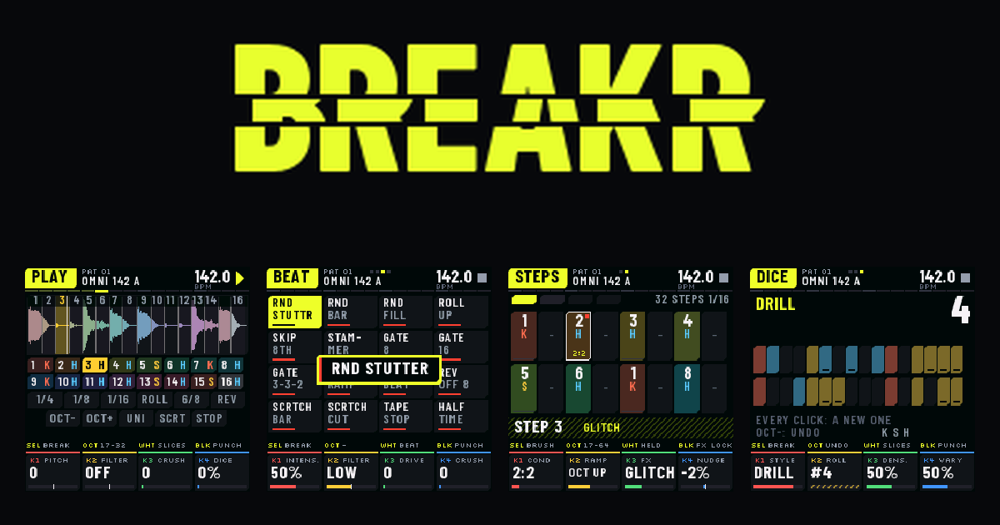

<a href="https://omnipotard.github.io/Breakr/#fr">https://omnipotard.github.io/Breakr/</a>

# BREAKR · firmware breakbeat pour le FM-1

[English](README.md) · **Français**

**Breakbeat, breakcore, IDM sur le M-VAVE FM-1.** Découpe n'importe quelle boucle sur ses frappes, séquence-la
sur 64 pas avec ratchets jusqu'à ×16, conditions et verrous d'effets, puis drille-la, détruis-la et
rééchantillonne-la. Libre et open source (GPL-3.0). *Version 0.4 **BÊTA** : compilée et vérifiée pour le FM-1
(taille, mémoire, mise à jour, des milliers de sessions aléatoires sous sanitizers), pas encore jouée sur le
matériel ; dis-moi ce que tu vois (onglet Issues).*

| | |
|---|---|
| 🎛 **Essayer** (navigateur) | [`emulator/index.html`](emulator/index.html) |
| ⬇️ **Installer** sur le FM-1 | [`installer.html`](installer.html) (Chrome ou Edge, USB) · ou `INSTALL-Windows.bat` / `INSTALL-Mac.command` / `INSTALL-Linux.sh` |
| 🥁 **Tes breaks** | [`editor/index.html`](editor/index.html) (ordinateur ou téléphone Android, sans appli) · ou **SAVE › RESAMPLE** sur le FM-1 · ou dépose une boucle sur l'émulateur |
| 📖 **Manuel** | [`manual.html`](manual.html#fr) |

## Ce qu'il fait

1. **8 breaks d'usine** (4 joués par Omnipotard, CC0 ; 4 synthétisés) et **8 à toi** ; découpés tels quels, en grille ou sur leurs frappes, chaque tranche classée kick / caisse claire / charleston.
2. **Séquenceur 64 pas** : ratchets jusqu'à **×16** avec une rampe, **conditions** (1:2 … 8:8, FIRST, PRE), chance, décalage, un effet verrouillé par pas ; le groove du break gardé ; patterns et chaînes.
3. **32 effets glitch**, les deux banques de K-GLITCH sur les touches blanches : **BEAT** (FX ×3 ; des programmes sur la mesure : stutters et fills au hasard, roll up, stammer, gates, reverse beat, scratchs, tape stop, half time) et **DESTROY** (FX ×4 ; loop destroy, stutter, glitch, scratch, reverse, pitch mad, gate, filter chaos, beat repeat, micro stutter, time stretch, ring mod, fuzz, total chaos…), chacun avec son intensité.
4. **11 effets punch** sur les touches noires (façon PO-33, dont deux gates trance ; sur les pages FX une fenêtre nomme celui que tu appuies) et **16 patterns flex** (façon Flex Beat).
5. **PAN** (ARP deux fois) : 16 effets entre les deux côtés, 6 au tempo (auto-pans, ping, triolets, cercle) et 10 glitch (hasard, clics, un stutter ou un envers d'un côté, sauts Haas, frappes séparées, inversions…).
6. **Générateurs** : DRILL, BREAKCORE, IDM, jungle, half time, boom bap, 2-step, glitch, build-up ; **dés** (libres ou verrouillés).
7. **RESAMPLE** sur le FM-1 : la sortie, effets compris, enregistrée dans un nouveau break, découpé et classé.
8. **Master** : un filtre à 5 types (DJ, bande, comb, voyelle, wah) qui peut bouger au tempo, un delay à 5 types (clean, dub qui s'emballe, ping-pong, reverse, lo-fi), coupe-bas, largeur, drive, crush, delay calé sur le tempo, compresseur.
9. **SHIFT et annuler** : HOME tenu, c'est SHIFT, et l'écran liste ce qu'il fait : un nouveau beat (SHIFT + LFO), effacer le pattern, gommer pendant la lecture, copier le pattern dans le suivant, verrouiller un effet punch ou glitch, couper les FX et les remettre, tout arrêter ; **16 modifications d'annuler et rétablir** (SHIFT + OCT− / OCT+). Sur GÉNÉRER, les touches blanches sont les 11 styles. Rien qui vide un pattern n'est à un seul appui.
10. **Il dit quoi fait quoi** : un bandeau au-dessus des knobs dit ce que font SELECT, OCT et les touches sur chaque page, SHIFT tenu ou non ; chaque knob montre son nom et sa valeur. 6 thèmes (SOFT : rond et doux pour les yeux). Français et anglais.

## Installer

1. FM-1 allumé, branché avec un câble USB de **données**, les autres logiciels MIDI fermés.
2. Ouvre [`installer.html`](installer.html#fr) dans Chrome ou Edge → « Installer BREAKR ».
3. Le paquet est dans [`install/`](install/) (`breakr-X.Y.fwsc`, sommes de contrôle dans `SHA256SUMS`) ; identifiant `FM-1_2002`.

Retour à KAWA, K-WASUB ou un autre firmware : installe son `.fwsc` de la même façon ; le firmware d'origine : M-UPGRADE. `OCT−` maintenu à l'allumage = secours USB. Une mise à jour ne touche jamais tes projets et tes breaks.

## Crédits

BREAKR par **Omnipotard**. Construit sur **Dinghy**, **Felucca** et **SLOOP**, la plateforme ouverte de la
communauté FM-1 (Leo Kuroshita / Hügelton Instruments, zvenson), comme KAWA. Les banques BEAT et DESTROY
viennent de **K-GLITCH**. Polices : Barlow Condensed et Silkscreen (SIL OFL 1.1).

☕ [ko-fi.com/omnipotard](https://ko-fi.com/omnipotard)
