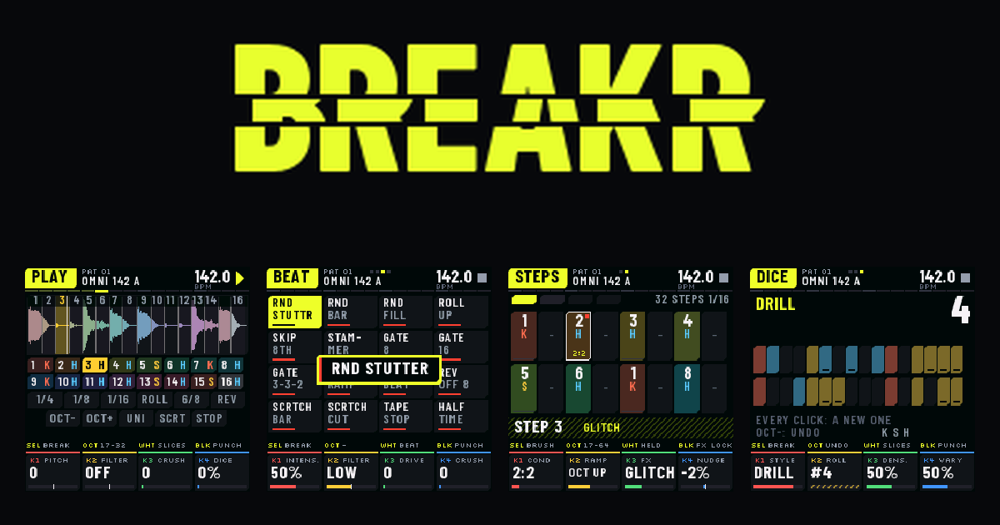

<p align="center"></p>
<p align="center"><a href="https://omnipotard.github.io/Breakr/">https://omnipotard.github.io/Breakr/</a></p>

# BREAKR · breakbeat firmware for the FM-1

**English** · [Français](README.fr.md)

**Breakbeat, breakcore, IDM on the M-VAVE FM-1.** Slice any loop on its hits, sequence it on 64 steps with
ratchets up to ×16, conditions and effect locks, then drill, destroy and resample it. Free and open source
(GPL-3.0). *Version 0.2 **BETA**: built and checked for the FM-1 (size, memory, the update path, thousands of
random sessions under sanitizers), not yet played on the hardware; tell me what you see (Issues tab).*

| | |
|---|---|
| 🎛 **Try it** (browser) | [`emulator/index.html`](emulator/index.html) |
| ⬇️ **Install** on the FM-1 | [`installer.html`](installer.html) (Chrome or Edge, USB) · or `INSTALL-Windows.bat` / `INSTALL-Mac.command` / `INSTALL-Linux.sh` |
| 🥁 **Your breaks** | [`editor/index.html`](editor/index.html) (computer or Android phone, no app) · or **SAVE › RESAMPLE** on the FM-1 · or drop a loop on the emulator |
| 📖 **Manual** | [`manual.html`](manual.html) |
| 🏠 **Home page** | [`index.html`](index.html) (GitHub Pages: <https://omnipotard.github.io/Breakr/>) |

## What it does

1. **8 factory breaks** (4 played by Omnipotard, CC0; 4 synthesized) and **8 of yours**; sliced as they are, on a grid or on their hits, each slice classed kick / snare / hat.
2. **64-step sequencer**: ratchets up to **×16** with a ramp (up, down, octave, random, fade, reverse every other), **conditions** (1:2 … 8:8, FIRST, PRE), chance, nudge, an effect locked per step; the break's own groove kept; patterns and chains.
3. **32 glitch effects**, K-GLITCH's two banks on the white keys: **BEAT** (FX ×3; programs over the bar: random stutter, random bar, random fill, roll up, skip 8th, stammer, four gates, reverse beat, reverse offbeat, scratch bar, scratch cut, tape stop, half time) and **DESTROY** (FX ×4; loop destroy, stutter, glitch, scratch, reverse, pitch mad, gate, filter chaos, beat repeat, beat skip, micro stutter, time stretch, ring mod, fuzz, randomizer, total chaos), each with its intensity.
4. **11 punch effects** on the black keys (PO-33 style; on the FX pages a window names the one you press) and **16 flex patterns** (Flex Beat style).
5. **Generators**: DRILL, BREAKCORE, IDM, jungle, half time, boom bap, 2-step, glitch, build-up; **dice** (FREE or LOCKed).
6. **RESAMPLE** on the FM-1: the output, effects and all, recorded into a new break, cut and classed.
7. **Master**: filter (low-pass left, high-pass right, clean through the middle), resonance, drive, crush, tempo-synced delay, compressor.
8. **It tells you what does what**: a strip over the knobs says what SELECT, OCT and the keys do on each page; HOME held lists every control. 5 themes. English and French.

## Install

1. FM-1 on, plugged in with a USB **data** cable, other MIDI software closed.
2. Open [`installer.html`](installer.html) in Chrome or Edge → “Install BREAKR”.
3. The package is in [`install/`](install/) (`breakr-X.Y.fwsc`, checksums in `SHA256SUMS`); identity `FM-1_2002`.

Back to KAWA, K-WASUB or another firmware: install its `.fwsc` the same way; the stock firmware: M-UPGRADE. Holding `OCT−` at power-on = USB rescue. An update never touches your projects and breaks.

## Build

```sh
cd source
sh tests/run_engine_test.sh              # the engine (UBSan, ASan): fidelity, timing, dice, glitch, steps, generators
sh tests/run_host.sh                     # the firmware on a computer: screens and sound in build/host/
node tests/web_e2e.js                    # web/brk.js against the firmware in WebAssembly (upload, RESAMPLE)
./build.sh --release 0.2                 # -> build/breakr-0.2.fwsc (JieLi toolchain + AC79 SDK: tools/get_toolchain.sh)
sh tests/run_loader_tests.sh             # the update path against that package
APP_VER=0.2 sh web/make_emulator.sh      # -> emulator/index.html
python3 web/make_site.py 0.2             # -> editor/, installer.html, install/
```

## Credits

BREAKR by **Omnipotard**. Built on **Dinghy**, **Felucca** and **SLOOP**, the FM-1 community's open platform
(Leo Kuroshita / Hügelton Instruments, zvenson), as KAWA. The BEAT and DESTROY banks come from **K-GLITCH**.
Fonts: Barlow Condensed and Silkscreen (SIL OFL 1.1). M-VAVE and FM-1 are their owners' names; BREAKR is not
made by them. See [`LICENSE`](LICENSE).

☕ [ko-fi.com/omnipotard](https://ko-fi.com/omnipotard)
